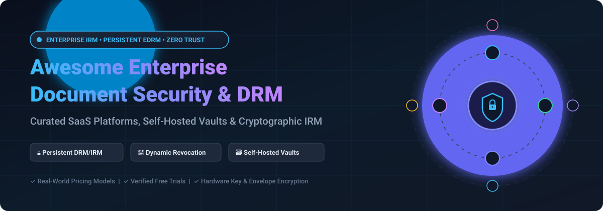

# 🛡️ Awesome Enterprise Document Security & DRM

  

  
  
  
  
  
  
  

---

## 📑 Top Enterprise Document Security & DRM Ecosystem

> 🎯 **A Curated Directory of Enterprise Information Rights Management (IRM), SaaS Document DRM Solutions, and Self-Hosted Open-Source File Protection Vaults.**  
> *Engineered for persistent file encryption, dynamic access policies, zero-trust distribution, remote revocation, and compliance (GDPR, HIPAA, ITAR, CMMC).*  
> **📅 Last updated: March 2026**

Enterprise Document Security and Digital Rights Management (EDRM / IRM) tools safeguard confidential documents, spreadsheets, PDFs, blueprints, and code artifacts **wherever they travel**—ensuring persistent encryption and granular usage rights (view, edit, print, copy-paste, screen-capture defense, dynamic watermarking) that travel directly with the file. Rights can be instantaneously revoked remotely even long after delivery outside corporate boundaries.

---

## 🧭 Table of Contents
- [📊 Sector Overview & Market Dynamics](#-sector-overview--market-dynamics)
- [☁️ SaaS / Hosted Enterprise DRM Platforms](#️-saas--hosted-enterprise-drm-platforms)
- [🔓 Open-Source GitHub Projects](#-open-source-github-projects)
- [⭐ Star History](#-star-history)
- [🤝 Support & Sponsorship](#-support--sponsorship)
- [💡 How to Contribute](#-how-to-contribute)
- [⚠️ Disclaimer](#️-disclaimer)

---

## 📊 Sector Overview & Market Dynamics

The global Enterprise Digital Rights Management (EDRM) and Document Security market is valued between **$4.4B and $6.1B** and projected to exceed **$14B to $17B** over the next decade (growing at a compound annual growth rate of 10%–13%+). 

The sector is **moderately fragmented**: mega-cap enterprise productivity giants (anchored by Microsoft Purview) dominate baseline operational security across standard office suites, while specialized and independent DRM, IRM, and Virtual Data Room (VDR) vendors capture substantial high-assurance enterprise market share by addressing complex, multi-cloud, cross-company, and zero-trust document governance scenarios.

---

## ☁️ SaaS / Hosted Enterprise DRM Platforms

| Product | Company Size (Valuation / Revenue) | Description | Starting Pricing | Free Tier / Trial Limits |
|---------|-----------------------------------|-------------|------------------|--------------------------|
| **[Microsoft Purview Information Protection](https://www.microsoft.com/en-us/security/business/information-protection/microsoft-purview-information-protection)** | ~$3.9T Market Cap / ~$346B Annual Revenue | 🏢 **The default choice for Microsoft 365 estates.** Protects documents where they are born—sensitivity labels trigger encryption and rights automatically. Purview Suite requires M365 E3 or Office 365 E3 + EMS E3. Ranks #1 for ecosystem-native rights in M365 environments. | **$12.00/user/month** (annual commitment, Microsoft Purview Suite add-on) | **90-day free trial** with up to 25 Microsoft Purview Suite licenses (requires M365 E3 tenant; no permanent free tier) |
| **[Fortra (Vera)](https://www.fortra.com/)** | ~$500M–$800M Annual Revenue (PE-backed) | 🛡️ **Pioneer of the "follow-the-file" persistent encryption model.** Dynamic policy and kill-switch revocation wherever the file travels. Sits beside Titus/BoldonJames classification for a label-to-rights chain. Revoke after delivery: Yes. Print/copy control: Yes. Screen-capture defense: Partial. | **$30.00/user/month** (billed annually, standard enterprise starting tier via sales quote) | **No free tier**; custom guided Proof-of-Concept (PoC) / demo provided upon request via sales |
| **[Virtru](https://www.virtru.com/)** | ~$500M Valuation / ~$30.5M Annual Revenue | ✉️ **Email-first control.** Best for organizations whose primary leak path is the inbox. End-to-end encryption for Gmail and Outlook with browser-based Secure Reader access for external recipients without software installation. | **$119.00/month** (billed annually; Starter plan covering 5 users) | **No free tier**; standard self-service free trial not offered (guided evaluations/demos via sales; free guest access for external recipients to read/reply) |
| **[Seclore](https://www.seclore.com/)** | ~$100M–$250M Valuation / ~$16M+ Annual Revenue | 🌐 **The deepest independent cross-company IRM.** Ecosystem-neutral—works across Microsoft, Google, and mixed estates. Browser-based no-plugin access for external recipients. Automation hooks attach rights as files leave DLP, ECM, or ERP systems. Revoke after delivery: Yes. Print/copy control: Yes. Screen-capture defense: Partial. | **$27,000.00/year** (baseline enterprise starting tier covering up to 100 users) | **No free tier**; standard self-service free trial not available (custom Proof of Concept / live enterprise demo upon sales engagement) |
| **[Fasoo Enterprise DRM](https://www.fasoo.com/)** | ~$35M–$40M Market Cap (KOSDAQ: 150900) / ~$35M Annual Revenue | 🔒 **DRM as the organization's default state.** Protect-at-creation automation, derivative-document control, and notably strong screen-capture defense. Proven at mega-scale with enterprise-wide deployments. Revoke after delivery: Yes. Print/copy control: Yes. Screen-capture defense: Yes. | **$180.00/month** (entry deployment starting estimate; custom enterprise pricing per endpoint) | **No free tier**; custom 14-to-30 day Proof-of-Concept evaluation license available upon request from sales |
| **[Digify](https://digify.com/)** | ~$3M–$5M Estimated Revenue / $4M+ Seed-funded | 📁 **Deal-room lane.** Positioned for secure document sharing and virtual data rooms (VDR) in M&A, fundraising, and confidential transactions with dynamic watermarking and access revocation. | **$190.00/month** (Pro plan; 1 user seat, 3 data rooms, 50 guests) | **7-day free trial** of Team plan features (no credit card required; phone verification required; no permanent free tier) |

---

## 🔓 Open-Source GitHub Projects

Below are the leading open-source repositories for document security, encrypted data distribution, rights management, and cryptographic vaults, sorted in descending order by GitHub stargazers:

| Project | GitHub_Stars | Description | Category / Primary Focus |
|---------|--------------|-------------|--------------------------|
| **[OpenPGP.js](https://github.com/openpgpjs/openpgpjs)** |  | 🔑 The world's most widely deployed open-source OpenPGP implementation in JavaScript/TypeScript. Powers end-to-end encrypted document exchange, digital document signing, and browser-based client-side file decryption engines (including Proton Mail and Webmail extensions). | Cryptographic Document Protocol & In-Browser Decryption |
| **[SecureDrop](https://github.com/freedomofpress/securedrop)** |  | 🕵️ Open-source whistleblower and confidential document submission system managed by Freedom of the Press Foundation. Employs Tor onion services and multi-layer PGP air-gapped encryption for secure document acquisition and redaction workflows. | Air-Gapped Confidential Document Acquisition |
| **[Readium LCP Server](https://github.com/readium/readium-lcp-server)** |  | 📖 Reference open-source DRM server implementation for the Readium Lightweight Content Protection (LCP) ISO standard. Governs cryptographic license distribution, user rights verification, and encrypted PDF/EPUB asset distribution for publishers and digital archives. | Open-Standard DRM Server (PDF/EPUB) |
| **[Cloakshare](https://github.com/cloakshare/cloakshare)** |  | 👁️ Open-source platform and API for secure document and video sharing with granular analytics. Enforces dynamic recipient watermarks, email access gates, self-destructing links, and per-page view tracking without client plugins. | Secure Document Sharing & Dynamic Watermarking |
| **[EDRLab LCP Server](https://github.com/edrlab/lcp-server)** |  | 🔏 High-performance Go implementation of the Readium LCP standard by the European Digital Reading Lab. Provides license generation, encrypted publication storage, and client passphrase validation for digital assets. | High-Performance Rights License Server |
| **[Vault-Zip](https://github.com/debeemedia/vault-zip)** |  | 📦 The most complete open-source encrypted file vault with license-based access control. Implements AES-256-GCM envelope encryption for files at rest, direct S3/MinIO streaming, and encryption key rotation with boot-time checks. Downloaded bundles are re-encrypted with the user's License Key into `.vault` files with zero server-side key exposure during decryption. | License-Gated Encrypted File Vault |
| **[Alcifra](https://github.com/HebelConsulting/Alcifra)** |  | 🪪 Sovereign document workspace with encryption bound to each user's own hardware security key (smartcard or YubiKey). Features encrypted delivery via public certificates where private keys never leave the card, alongside HSM-backed at-rest encryption and WebDAV/IMAP protocol support. | Hardware-Key-Sealed Sovereign Document Workspace |
| **[ILDRM Platform](https://github.com/ildrm/digital-rights-management-platform)** |  | 🔐 Full-stack TypeScript open-source digital rights management and licensing platform. Provides policy-based entitlements, device-bound signed licenses, encrypted content packaging, OIDC APIs, PostgreSQL, OpenBao, and S3-compatible storage. | Self-Hosted Enterprise DRM Foundation |
| **[Docshare](https://github.com/hayward-solutions/docshare)** |  | 👥 Lightweight self-hosted document sharing platform featuring granular permission controls, group-based authorization, S3-compatible backend storage, and audit logging. | Self-Hosted Permission-Controlled Sharing |

---

## 📈 Star History

---

## 💖 Support & Sponsorship

If you found this curated list helpful for your organization's security architecture or cryptographic research:
- ⭐ **Star** this repository on GitHub to help others discover it!
- 🍴 **Fork** the repository and contribute entries or corrections.
- 📢 **Share** it with your engineering, cybersecurity, and compliance teams.
- ☕ If you'd like to support ongoing research and open-source maintenance, please consider buying a coffee or becoming a sponsor via the **[GitHub Sponsor Dashboard](https://github.com/sponsors/ishandutta2007)**.

Thank you to all community contributors, security architects, and project maintainers keeping data protection open and accessible! 🚀

---

## 💡 How to Contribute

1. 🍴 Fork the repository.
2. ✍️ Add or edit entries in `README.md` (adhere to existing table layouts, pricing transparency, and badge links).
3. 🔗 Include: name, official link, stargazers badge (for open source), 1–2 sentence factual description, and pricing/trial specifics.
4. 🚀 Submit a Pull Request with a short summary of the addition or update.

---

## ⚠️ Disclaimer

- This is an **independent, community-curated directory** intended for educational and architectural evaluation purposes—not an explicit endorsement or warranty.
- Enterprise document security and DRM platforms handle mission-critical, confidential business assets and cryptographic keys. Organizations must always enforce strict key management (HSM where possible), zero-trust network boundaries, audit logging, and compliance with relevant regulatory standards (GDPR, HIPAA, SOC 2, ISO 27001, ITAR, CMMC).
- **Persistent Rights Control vs. Transit Encryption**: Verify whether your threat model necessitates **persistent usage rights that survive distribution and forwarding** (commercial IRM/DRM with screen-capture and print prevention) or **confidentiality in storage and transit** (open-source envelope encryption and license-gated vaults) prior to implementation.

---

  <b>Built with ❤️ for security engineers, compliance officers, and teams protecting sensitive enterprise data.</b>

